# Entity relationship diagram

The diagram reflects the current migrations. JSON columns hold immutable booking/catalog snapshots and flexible website/business settings; they do not replace the normalized operational records shown below.

```mermaid
erDiagram
    USERS ||--o{ ROLE_USER : assigned
    ROLES ||--o{ ROLE_USER : grants
    ROLES ||--o{ PERMISSION_ROLE : includes
    PERMISSIONS ||--o{ PERMISSION_ROLE : granted
    USERS ||--o{ CUSTOMER_VEHICLES : owns
    VEHICLE_BRANDS ||--o{ VEHICLE_MODELS : defines
    VEHICLE_CATEGORIES ||--o{ VEHICLE_MODELS : classifies
    VEHICLE_MODELS ||--o{ CUSTOMER_VEHICLES : identifies
    VEHICLE_MODELS ||--o{ VEHICLE_GENERATIONS : separates
    VEHICLE_GENERATIONS ||--o{ VEHICLE_MODEL_YEARS : covers
    VEHICLE_GENERATIONS ||--o{ VEHICLE_VARIANTS : defines
    VEHICLE_VARIANTS ||--o{ VEHICLE_VARIANT_YEAR : applies_to
    VEHICLE_MODEL_YEARS ||--o{ VEHICLE_VARIANT_YEAR : supports
    VEHICLE_VARIANTS ||--o{ VEHICLE_VARIANT_ATTRIBUTES : describes
    VEHICLE_VARIANTS ||--o{ CUSTOMER_VEHICLES : identifies
    USERS ||--o{ CUSTOMER_VEHICLE_MODEL_REQUESTS : requests
    SERVICE_CATEGORIES ||--o{ SERVICES : groups
    SERVICES ||--o{ SERVICE_PART_VARIANTS : configures
    PART_VARIANTS ||--o{ SERVICE_PART_VARIANTS : offered_with_service
    SERVICES ||--o{ SERVICE_OPTION_GROUPS : offers
    SERVICE_OPTION_GROUPS ||--o{ SERVICE_OPTIONS : contains
    SERVICE_CATEGORIES ||--o{ PACKAGES : groups
    PACKAGES ||--o{ PACKAGE_ITEMS : contains
    PART_CATEGORIES ||--o{ PARTS : groups
    PART_BRANDS ||--o{ PARTS : brands
    PARTS ||--o{ PART_VARIANTS : configures
    PART_VARIANTS ||--o{ PART_VARIANT_VEHICLE_MODEL : fitment
    VEHICLE_MODELS ||--o{ PART_VARIANT_VEHICLE_MODEL : fitment
    VEHICLE_VARIANTS ||--o{ PART_VARIANT_VEHICLE_MODEL : narrows_fitment
    PART_VARIANTS ||--o{ PART_VARIANT_ATTRIBUTE : specifies
    PRODUCT_ATTRIBUTE_VALUES ||--o{ PART_VARIANT_ATTRIBUTE : value
    USERS ||--o{ BOOKINGS : submits
    CUSTOMER_VEHICLES ||--o{ BOOKINGS : selected_for
    BOOKINGS ||--o{ BOOKING_ITEMS : snapshots
    BOOKINGS ||--o{ BOOKING_STATUS_HISTORIES : records
    BOOKINGS ||--o{ BOOKING_CHANGE_REQUESTS : receives
    BOOKINGS ||--o{ APPOINTMENTS : schedules
    APPOINTMENTS ||--o{ MECHANIC_ASSIGNMENTS : staffed
    MECHANIC_PROFILES ||--o{ MECHANIC_ASSIGNMENTS : works
    USERS ||--o| MECHANIC_PROFILES : has
    SERVICE_CATEGORIES ||--o{ MECHANIC_SPECIALIZATIONS : qualifies
    MECHANIC_PROFILES ||--o{ MECHANIC_SPECIALIZATIONS : qualifies
    APPOINTMENTS ||--o{ APPOINTMENT_HISTORIES : records
    BOOKINGS ||--o| WORK_ORDERS : creates
    APPOINTMENTS ||--o{ WORK_ORDERS : scheduled_for
    WORK_ORDERS ||--o{ WORK_ORDER_ITEMS : contains
    WORK_ORDERS ||--o{ WORK_ORDER_CHECKLISTS : checks
    WORK_ORDERS ||--o{ INSPECTIONS : documents
    INSPECTIONS ||--o{ INSPECTION_FINDINGS : finds
    INSPECTION_FINDINGS ||--o{ INSPECTION_MEDIA : evidences
    WORK_ORDERS ||--o{ WORK_RECOMMENDATIONS : proposes
    WORK_RECOMMENDATIONS ||--o{ RECOMMENDATION_DECISION_HISTORIES : preserves
    USERS ||--o{ RECOMMENDATION_DECISION_HISTORIES : decides
    WORK_RECOMMENDATIONS ||--o{ STOCK_RESERVATIONS : reserves
    PART_VARIANTS ||--o{ STOCK_LEVELS : stocked
    INVENTORY_LOCATIONS ||--o{ STOCK_LEVELS : stores
    STOCK_LEVELS ||--o{ STOCK_MOVEMENTS : records
    STOCK_LEVELS ||--o{ STOCK_RECEIPTS : receives
    BOOKINGS ||--o{ PAYMENTS : paid
    PAYMENTS ||--o{ PAYMENT_VERIFICATIONS : reviewed
    BOOKINGS ||--o{ REFUNDS : refunded
    BOOKINGS ||--o{ STOCK_RESERVATIONS : reserves
    USERS ||--o{ NOTIFICATIONS : receives
    USERS ||--o{ EXPENSES : records
    USERS ||--o{ AUDIT_LOGS : acts
    USERS ||--o{ WORKSHOP_CLOSURES : configures
```

`website_content` and `business_settings` are key/value tables. `workshop_closures` stores holidays and special hours. Vehicle generations, years, trims, trim-year applicability, attributes, customer requests, service-part options, and fitment provenance are normalized. `booking_items`, booking status histories, work-order items, recommendation decision histories, and payment/refund rows preserve transaction history. See [data dictionary](DATA_DICTIONARY.md) for table responsibilities.
